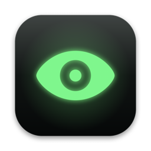

<p align="center">
  
</p>

<h1 align="center">ArgusLid</h1>

<p align="center">
  <b>Close the lid. Screen goes dark. Your Mac keeps working.</b><br>
  合上盖子，屏幕熄灭，Mac 继续工作。
</p>

<p align="center">
  <a href="../../releases/latest"></a>
  
  
  
</p>

<p align="center"><a href="#中文">中文说明</a></p>

---

ArgusLid is a tiny macOS menu bar app that keeps your MacBook **running with the lid closed**, on battery, with **no external display, keyboard or mouse needed**. And unlike most keep-awake tools, it makes sure the **screen actually turns off** when you close the lid.

Downloads, builds, renders, backups, SSH sessions, local LLMs, AI agents and servers keep going while the lid is shut. The display stays dark and cool.

> **Why the name?** In Greek myth, Argus Panoptes was the hundred-eyed giant who never fully slept: he closed only some of his eyes and the rest kept watch. **ArgusLid**: the lid is closed, but your Mac is still awake.

## Why another keep-awake app?

There are plenty of good "keep awake" apps for macOS: **Amphetamine**, **KeepingYouAwake**, **Caffeine**, **Lungo**, **Theine**, **InsomniaX**, **NoSleep**, and the built-in `caffeinate` command. They fall into two groups:

1. **Tools built on power assertions** (`caffeinate`, KeepingYouAwake, Caffeine, Lungo, Theine…) stop *idle* sleep. But macOS still forces sleep **the moment you close the lid**, unless you're in Apple's clamshell mode (charger + external display + keyboard/mouse).
2. **Tools that do keep the Mac awake with the lid closed** often leave the **built-in display backlight on** behind the closed lid. That wastes battery, adds heat and can cause burn-in.

ArgusLid was built to fix exactly that:

| | ArgusLid |
|---|---|
| Stays awake with the lid closed, on battery, no external display | ✅ |
| Turns **all screens off** the instant the lid closes | ✅ |
| Turns screens off again if something wakes them while the lid is closed | ✅ |
| Locks the screen on lid close (optional; programs keep running either way) | ✅ |
| One switch to manage the lid; separately choose how long to keep running: None / ∞ / 30m / 1h / 2h / 4h / 8h / custom | ✅ |
| Battery guard: stop keeping awake below 10/20/30/50% (and sleep right away if the lid is closed) | ✅ |
| Stop keeping awake when the charger is unplugged (optional) | ✅ |
| One-click toggle, no password after one-time setup | ✅ |
| Restores normal sleep when you quit | ✅ |
| One-click in-app updates | ✅ |
| Native SwiftUI + Liquid Glass, ~300 KB, no dependencies, open source | ✅ |

If you're searching for an **Amphetamine alternative**, a **closed-lid / clamshell mode without an external monitor**, or a way to **prevent MacBook sleep when the lid is closed while turning the display off**, this is it.

## Install

### Option 1: one command (recommended, no security warning)

Paste this into Terminal:

```bash
curl -fsSL https://raw.githubusercontent.com/GZhengHao/argus-lid/main/install.sh | bash
```

It downloads the latest release, verifies its SHA-256, puts `ArgusLid.app` in `/Applications` and launches it. Files downloaded with `curl` aren't tagged as "from the internet", so macOS opens the app straight away, with **no "Apple could not verify" dialog**. The [script](install.sh) is short; read it first if you like. Run the same command again any time to upgrade.

### Option 2: DMG

1. Download **`ArgusLid-x.y.z.dmg`** from [**Releases**](../../releases/latest), open it, and drag **ArgusLid** onto **Applications**.
2. ArgusLid is a free open-source app that isn't notarized by Apple ($99/year developer program), so on first launch macOS says *"Apple could not verify 'ArgusLid' is free of malware"*. Click **Done** (**not** Move to Trash), then open **System Settings → Privacy & Security**, scroll down, and click **Open Anyway**.

### After installing

Click the 👁 icon in the menu bar, then **Settings → Passwordless toggle**, and enter your password once. ArgusLid checks GitHub for new versions and **updates itself in one click**, so you won't see the security warning again.

### Build from source

Only Xcode Command Line Tools are needed:

```bash
git clone https://github.com/GZhengHao/argus-lid.git
cd argus-lid
./build.sh            # → build/ArgusLid.app
./build.sh release    # → also dist/ArgusLid-<version>.zip
```

## How it works

| Step | Mechanism |
|---|---|
| Keep the system awake with the lid closed | `pmset -a disablesleep 1` (the only reliable way; power assertions don't survive a lid close) |
| Detect the lid | IOKit clamshell-state notifications on `IOPMrootDomain` (instant), with a 2 s poll as fallback |
| Turn screens off | `pmset displaysleepnow` on lid close; repeated every 10 s if a display wakes while the lid stays shut |
| Battery / charger | `IOPowerSources` |
| No password prompts | Optional sudoers rule in `/etc/sudoers.d/argus` that allows **only** `pmset -a disablesleep 0` and `pmset -a disablesleep 1`, validated with `visudo` before install. You can remove it from Settings at any time. |

Automatic actions (timer end, low battery, unplugged) **never** show a password dialog. If nobody is there to type a password, a blocking dialog would hang. Without the passwordless rule, ArgusLid tells you it couldn't switch itself off instead.

## ⚠️ Be careful

- **Don't put a running, lid-closed MacBook in a bag.** With no airflow it can get hot. Use the battery guard and a timer.
- `disablesleep` is a system-wide setting that persists across reboots. ArgusLid turns it off when you quit, but if the app is force-killed, turn it off with:
  ```bash
  sudo pmset -a disablesleep 0
  ```

## Requirements

macOS 26 (Tahoe) or later, Apple Silicon or Intel.

## License

MIT

---

<a id="中文"></a>

## 中文

**ArgusLid** 是一个 macOS 菜单栏小工具：**合上 MacBook 盖子后，屏幕熄灭，系统继续运行**。用电池也行，不需要外接显示器、键盘或鼠标。

下载、编译、渲染、备份、SSH、本地大模型、AI Agent、服务器……合盖后照常运行，屏幕全黑，不费电也不发热。

### 为什么要做它

市面上的防休眠软件已经不少：**Amphetamine**、**KeepingYouAwake**、**Caffeine**、**Lungo**、**Theine**、**InsomniaX**、**NoSleep**，还有系统自带的 `caffeinate` 命令。但它们有两个常见问题：

1. **基于电源断言的工具**（caffeinate、KeepingYouAwake、Caffeine、Lungo、Theine 等）只能阻止"闲置睡眠"。**一合盖系统照样会睡**，除非同时接着电源、外接显示器和键盘鼠标，进入苹果官方的"合盖模式"。
2. **能让合盖不休眠的工具**，合盖后**内屏背光往往还亮着**，既费电又发热，还可能烧屏。

ArgusLid 就是为了解决这个问题而做的：**合盖瞬间主动熄灭所有屏幕**。盖子合着期间屏幕如果被唤醒，它会再次熄灭。

### 功能

- 一个总开关管理合盖行为；「合盖后保持运行」单独选：无 / ∞ / 30 分钟 / 1 / 2 / 4 / 8 小时 / 自定义
- 合盖瞬间熄灭所有屏幕，可选同时锁屏（锁屏不影响程序运行）
- 定时运行中可以随时延长，时间到后自动回到「无」（只熄屏/锁屏，系统照常睡眠）
- 电池保护：电量低于 10/20/30/50% 时停止保持运行，盖子合着会直接睡眠
- 拔掉电源时停止保持运行（可选）
- 开机自动启动
- 设置一次免密后，切换不用再输密码
- 退出时自动恢复正常睡眠
- App 内一键更新
- 原生 SwiftUI + Liquid Glass 界面，约 300 KB，无任何依赖，开源

### 安装

**方法一：一行命令（推荐，不会弹安全提示）**

复制到「终端」运行：

```bash
curl -fsSL https://raw.githubusercontent.com/GZhengHao/argus-lid/main/install.sh | bash
```

它会下载最新版、校验 SHA-256、放进「应用程序」并自动打开。用 `curl` 下载的文件不会被打上「来自网络」的标记，所以**不会出现「Apple 无法验证」的提示**。[脚本](install.sh)很短，可以先看看。以后重新运行这条命令就能升级。

**方法二：DMG 安装包**

1. 从 [**Releases**](../../releases/latest) 下载 **`ArgusLid-x.y.z.dmg`**，打开后把 **ArgusLid** 拖到 **应用程序**
2. ArgusLid 是免费开源软件，没有付费参加苹果的开发者计划（99 美元/年）做公证，首次打开会提示 **「Apple 无法验证"ArgusLid"…」**。点 **完成**，**不要**点「移到废纸篓」，然后打开 **系统设置 → 隐私与安全性**，往下滚，点 **仍要打开**

**装好之后**

点击菜单栏的 👁 图标，进入「设置 → 免密切换」，输一次密码。ArgusLid 会自动检查 GitHub 上的新版本，**一键更新**，以后不会再看到安全提示。

### 注意

- **不要把合着盖、还在运行的 MacBook 放进包里**，没有散热会发烫。建议开启电池保护和定时。
- 如果 App 被强制结束，可以手动恢复正常睡眠：`sudo pmset -a disablesleep 0`

### 名字由来

阿耳戈斯（Argus Panoptes）是希腊神话中的百眼巨人。他睡觉时只合上一部分眼睛，其余的眼睛始终醒着守望。**ArgusLid** = Argus + Lid（盖子，也是「眼睑」）：合上盖子，Mac 依然醒着。

---

<sub>Keywords: keep mac awake lid closed, prevent sleep when lid closed, macbook closed lid mode without external display, clamshell mode battery, amphetamine alternative, caffeinate lid closed, keepingyouawake alternative, disable sleep macOS, screen off but keep running, 合盖不休眠, 合盖不睡眠, Mac 防休眠, 合盖屏幕熄灭, Amphetamine 替代</sub>
